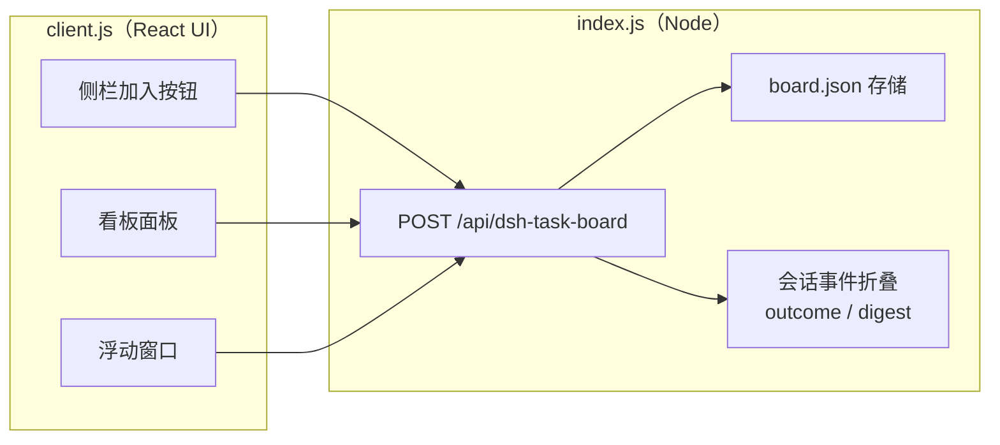

# 任务看板 · DSH Task Board

> 钉在 DeepSeek Harness 侧边栏上的一张任务看板。多个 AI 任务以卡片形式停在板上；点开任意一张，它就变成一块浮动窗口，里面跑着这个任务完整的会话——聊天、追问、继续干活都不耽误。

[](LICENSE)
[](https://www.deepseek.com)
[](#)

---

## 为什么需要它

用 DSH 同时跑几个任务时，会话分散在侧边栏里：哪个跑完了？哪个在等你的决定？哪个卡死了？你得一个个点开看。

任务看板把这件事变成**一眼**：

- 每个任务一张卡片，停在自己的工作区分区里；
- 卡片上直接写清它此刻在干什么（在调什么工具、思考了多久、最后输出了什么）；
- 需要你关注的卡片自动排到前面；
- 点开卡片才「拿起」这个会话——一个浮动窗口，原样承载完整对话；收回窗口，卡片回到原位。

**卡片在板上** 与 **窗口在浮层** 互斥：看到一张卡，就说明它此刻安静地停着；看不到它，就说明它正在窗口里干活。

## ✨ 功能一览

### 🗂 看板：按工作区分区

- **工作区分区（lane）**：点「关注工作区」把已有工作区排到板上，每个工作区一列，卡片各归其位。
- **分区排序**：拖拽分区标题即可调整左右顺序，顺序会被记住。
- **1 / 2 / 3 行布局**：工作区多时可切成多行排布，不改变卡片大小。
- **取消关注**：分区清空后可以取消关注；还有任务的分区会拦住你，避免卡片「凭空消失」。
- **未绑定工作区兜底**：工作区被删掉、或卡片找不到归属时，卡片进入「未绑定工作区」一列，永远可见。
- **会话上板**：把侧边栏里的会话直接拖到看板上，或点该会话行悬浮出现的「加入看板」按钮。

### 🃏 任务卡片：一眼看清任务在干什么

每张卡片实时显示：

- **状态**：草稿 / 运行中 / 需决策 / 已完成 / 故障停止 / 已停止（外加短暂的「结算中」过渡态）。
- **动态行**：正在调用什么工具（`⚙ Bash · npm test`）、正在写（`✎ 正在写`）、思考中且已运行多久（`思考中 · 3:24`）。
- **最后输出**：最近一条有内容的输出预览，悬停展开全文。
- **静默检测**：运行中但超过 60 秒没有任何事件 → 显示「静默 1:05」提醒；超过 5 分钟标红，卡死一眼可见。
- **运行时长**：运行中的卡片右上角实时计时。
- **钉住**：钉住的卡片永远置顶，并保持创建顺序。
- **移除**：从看板移除卡片（会话本身不受影响）；草稿里已经写了内容的，要点两次确认，防手滑。
- **智能排序**：同一分区内按「需要你关注的程度」排序——故障停止 → 需决策 → 运行中 → 已停止 → 已完成 → 空闲 → 草稿。
- **一键继续**：失败或停止的卡片右下角有「▶ 继续」，不用打开窗口，直接给该会话补发一条「继续」。

### 🪟 浮动窗口：任务就在手边

- **完整会话**：窗口里就是该任务的聊天流、输入框、待确认提问——和主界面里操作会话完全一致，连输入框的快捷操作都在。
- **拖动与缩放**：拖标题栏移动，八向缩放（四边 + 四角），最小 340×240。
- **记住位置**：同一个卡片再次打开时，尺寸和位置沿用上次（本页面会话内）。
- **永不失联**：窗口会自动避开应用标题栏，不会钻到看不见的地方；窗口被拖到屏幕外会自动拉回；窗口切换大小后自动重新贴合屏幕。
- **文件引用直达**：会话里出现的文件引用（如 `src/app.js`），在浮动窗口中点击会直接在系统文件管理器里**定位到该文件**（Windows 资源管理器 / macOS Finder），只会选中、不会执行文件，安全。
- **收回即归位**：点窗口右上角 `−`，会话引用被释放，卡片回到它原来的分区和位置。

### ⏰ 峰谷时钟

看板顶部居中有一枚小徽标，显示此刻 DeepSeek 处于**计费峰时还是谷时**：

- **峰**：工作日（周一至周五）北京时间 9:00–12:00 与 14:00–18:00，共 7 小时；
- **谷**：其余时间——午休、晚间、夜间及周末全天，维持半价；
- 谷时显示距离下一个峰时开始的倒计时，方便你挑便宜的时候跑大任务。

### 🛡 不丢数据

- 看板自动持久化到 `~/.dsh/storages/dsh-task-board/board.json`（可用 `DSH_HOME` 改根目录）。
- **原子写入**：临时文件 + 原子重命名，中途断电不会写出半个文件。
- **防回滚**：页面内状态优先于磁盘；热更新/重进面板不会把看板「退回旧状态」。
- **防覆盖**：读回磁盘文档之前绝不写盘，避免一次失败的加载把整个看板清空。
- **自动备份**：卡片数变少时先把上一版存为 `board.json.bak`。
- **状态可恢复**：每个 Turn 的结局（完成/失败/中止）随卡片持久化，重启 Host 后卡片仍然给出正确的结论，而不是统统显示为「已完成」。

### 🌐 中英双语与无障碍

- 内置 `zh` / `en` 两套文案，跟随 DSH 语言设置。
- 卡片支持键盘操作（Tab 聚焦，Enter / 空格打开）。
- 尊重系统「减少动态效果」设置。

## 📦 安装

前置：已安装 **DSH**（DeepSeek Harness）并至少有一个 profile（如 `web`、`desktop`）。

```bash
# 从 GitHub 安装（推荐）
dsh plugin --profile web add git+https://github.com/MWGE22629/dsh-task-board.git

# 或从 GitLink 安装
dsh plugin --profile web add git+https://www.gitlink.org.cn/GeDaamn/dsh-task-board.git

# 或从本地目录安装（开发时）
dsh plugin --profile web add link:D:/path/to/dsh-task-board
```

然后把包名加入该 profile 的 `package.json` 中 `dsh.profile.bundles` 数组：

```json
{
  "dsh": {
    "profile": {
      "bundles": ["…", "@local/dsh-task-board"]
    }
  }
}
```

重启 DSH，侧边栏出现「任务看板」图标即安装完成。

> 注：本插件包名为 `@local/dsh-task-board`（历史原因），安装命令与 bundles 都按此名引用。

## 🚀 快速上手

1. 点击侧边栏的**任务看板**图标。
2. 点右上角「**关注工作区**」，选一个工作区排到板上（可多选，一次一个）。
3. 在分区右上角点「**+**」新建一张任务卡，点开卡片，在浮动窗口里写下**第一条指令**，按 `Enter` 发送（`Shift+Enter` 换行）——DSH 会在该工作区创建会话并开始执行。
4. 也可以不新建：把侧边栏里的**已有会话拖到看板**上，或点会话行上的「加入看板」，它就会变成一张卡片。
5. 卡片跑到「已完成 / 故障停止 / 已停止」时，状态一目了然；失败或停止的卡片点「**▶ 继续**」让 AI 接着干。

## 🗂 数据存储

| 位置 | 内容 |
| --- | --- |
| `~/.dsh/storages/dsh-task-board/board.json` | 看板文档：分区、卡片、钉住、草稿文本、卡片↔会话映射 |
| `~/.dsh/storages/dsh-task-board/board.json.bak` | 上一版备份（卡片数变少时生成） |

**会话内容本身不存在这里**——它始终留在 DSH 自己的会话日志中。看板只保存「哪张卡对应哪个会话」这类无法推导的事实。

## 🧩 实现概览（给想改的人）

插件由两半组成，通过一条专用 RPC 路由通信：



- **Host 半**（`index.js`）：持有唯一一份 JSON 文档，串行化读写、原子落盘；从全局 `session/event` 折叠出每个会话的 **Turn 结局**与**实时摘要**（正在调什么工具、流式输出到了哪），并对停在看板上的卡片提供**日志回溯**兜底。
- **Client 半**（`client.js`）：纯 React 界面。缝合点：`sidebar.panellist`（侧栏图标）、`main`（看板本体）、`shell.overlay`（浮动层）、会话级子槽 `taskboard.window`（窗口内的会话内容）、`sidebar.workspaces.session.row.action`（会话行「加入」按钮）。
- **设计约束**：停在看板上的卡片**不订阅任何会话流**——窗口才持有会话引用，窗口关闭即释放；看板对运行中任务的了解，全部来自 Host 侧按秒合并的轻量摘要轮询。

## ❓ 常见问题

**看板显示「存储不可用」怎么办？**
Host 的 RPC 路由尚未就绪（刚启动或插件加载失败）。稍等几秒会自动重试；若一直如此，检查 DSH 日志中是否有 `[dsh-task-board]` 开头的报错。

**卡片显示「该会话已不存在」？**
会话日志被删除或迁移出了当前 DSH_HOME。卡片仍会保留，你可以移除它，或重新给该工作区建新任务。

**窗口打开是空白 / 报错？**
先确认 DSH 客户端版本支持 `shell.overlay` 与 `taskboard.window` 槽位（本插件依赖会话级子槽渲染完整对话）。收起再打开一次通常即可恢复。

**会把会话内容传到哪里吗？**
不会。所有数据都在这台机器的 DSH 存储内，插件不发起任何外部网络请求。

## 📄 License

[MIT](LICENSE)
