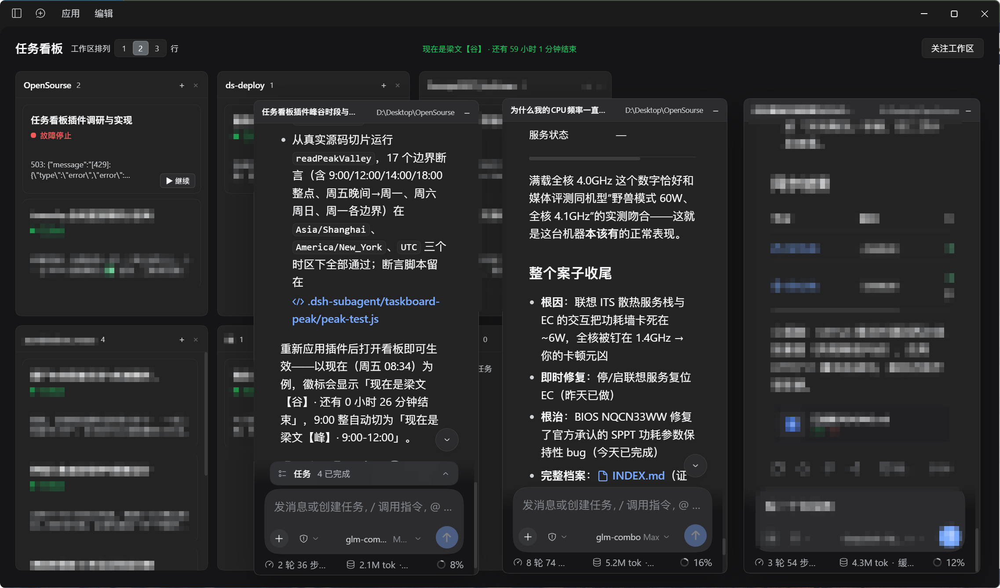
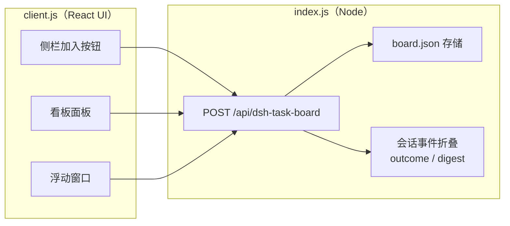

# 任务看板 · DSH Task Board

> 钉在 DeepSeek Harness 侧边栏上的一张任务看板。把不同工作区的会话排成卡片停在板上——进度写在卡面上，点开是独立浮动窗口，多开互不打扰。

[](LICENSE)
[](https://www.deepseek.com)
[](#)

---



*实拍：看板按工作区分区，右侧同时开着多张浮动窗口；卡片上直接显示运行状态与最近输出。*

## 它解决的四个问题

用 DSH 同时跑多个任务时，侧边栏会变得很难用。任务看板针对四个具体痛点给出了对应解法。

### 1️⃣ 左侧栏里「工作区和会话对不上号」→ 关注工作区 + 分区展示

左栏把不同工作区的会话混在一起，想知道某个会话属于哪个目录，得一个个点开看。

- 点「**关注工作区**」，把工作区排到看板上，**一个工作区一列**，它名下的会话卡片各归其位；
- 分区可**拖拽排序**，顺序会记住；工作区多时可切成 **1 / 2 / 3 行**布局；
- 分区里没有任务才能取消关注，还有任务的分区会被拦住——卡片不会因为取消关注而「凭空消失」；
- 工作区被删了？卡片进入「**未绑定工作区**」兜底列，永远找得到。

### 2️⃣ 左侧会话「进度不直观」→ 卡片实时预览 + 一键继续

侧边栏只告诉你「在跑」或「没在跑」，看不出跑到哪了。

- 卡片直接显示**它此刻在干什么**：⚙ 调用了什么工具（`Bash · npm test`）、✎ 正在写、思考中并计时；
- 卡片底部是**最近一条输出**的预览，悬停展开全文；
- **静默检测**：运行中超过 60 秒没有任何事件就显示「静默 1:05」，超过 5 分钟标红，卡死一眼可见；
- 失败或停止的卡片右下角有「**▶ 继续**」——不用打开窗口，直接给该会话补发一条「继续」，让它接着干。

### 3️⃣ 「一次只能看一个会话」→ 浮窗式多会话查看

- 点开卡片 → 弹出**浮动窗口**，里面就是这个任务完整的会话（消息流、输入框、待确认提问，和主界面完全一致）；
- 可以**同时开多个窗口**，拖拽移动、**八向缩放**（四边 + 四角），互不抢焦点；
- 点 `−` 或按 `Esc` 收回**当前浮窗**（以最后点选或刚打开的窗口为准），会话引用立即释放，卡片回到原来分区的位置；
- 窗口里的任务正在跑时，`Esc` 仍归 DSH 的「双击中止」所有——先停下，再按 `Esc` 收回窗口；
- 窗口会自动避开应用标题栏、被拖出屏幕会自动拉回，**不会失联**。

### 4️⃣ 「状态不明确、重点不突出」→ 按关注度排序

同一分区内的卡片自动按「需要你处理的程度」排序：

**故障停止 → 需决策 → 运行中 → 已停止 → 已完成 → 空闲 → 草稿**

扫一眼就知道该先管谁，而不是在十几个会话里翻找。

## 细节适配

和 DSH 本体的运行环境磨合后补上的几处：

- **会话完成状态透传**：Host 从会话事件里读出每个 Turn 的真实结局（完成 / 失败 / 中止），原样透传到卡片并随卡片持久化——DSH 重启后，失败也不会被误读成「已完成」。
- **rewind 联动**：浮动窗口嵌入的是标准会话内容，DSH 的 `/rewind`（回退对话与文件）在窗口里照常可用，回退后卡片照常跟踪状态。
- **蓝色文件标签直达目录**：会话里蓝色的文件标签，点一下直接在系统文件管理器打开**文件所在目录**（Windows 会选中该文件），不再依赖右侧预览栏。
- **独立的置顶会话**：钉住（📌）的卡片独立于排序规则，永远置顶并按创建顺序排列——排序是「系统帮你挑」，钉住是「我说了算」。

## 性能与数据存储优化

- **原子写**：临时文件 + 原子重命名，写到一半断电也不会留下坏文件。
- **结局持久化，重启不误判**：Turn 结局随卡片落盘，Host 重启、页面重开都不会把失败/中止误判为完成。
- **.bak 备份**：卡片数变少时先把上一版存为 `board.json.bak`——看板被意外清空还能找回。
- **八向缩放**：四边 + 四角共 8 个方向，最小 340×240，放大缩小都从你抓住的那条边开始。
- **位置记忆**：同一张卡再次打开时沿用上次的尺寸与位置（本页面会话内，不写盘）。

## 还有两件小事

- **峰谷时钟**：看板顶部居中的徽标显示此刻 DeepSeek 处于计费**峰时**还是**谷时**——工作日 9:00–12:00 / 14:00–18:00（北京时间）为峰，其余时段半价；谷时显示距下一个峰时的倒计时，方便挑便宜的时候跑大任务。
- **中英双语与无障碍**：内置 `zh` / `en` 文案；卡片支持键盘操作（Tab 聚焦，Enter / 空格打开）；尊重系统「减少动态效果」设置。

## 安装

前置：已安装 **DSH**（DeepSeek Harness）并至少有一个 profile（如 `web`、`desktop`）。

```bash
# 从 GitHub 安装（推荐）
dsh plugin --profile web add git+https://github.com/MWGE22629/dsh-task-board.git

# 或从 GitLink 安装
dsh plugin --profile web add git+https://www.gitlink.org.cn/GeDaamn/dsh-task-board.git

# 或从本地目录安装（开发时）
dsh plugin --profile web add link:D:/path/to/dsh-task-board
```

然后把包名加入该 profile 的 `package.json` 中 `dsh.profile.bundles` 数组：

```json
{
  "dsh": {
    "profile": {
      "bundles": ["…", "@local/dsh-task-board"]
    }
  }
}
```

重启 DSH，侧边栏出现「任务看板」图标即安装完成。

> 注：本插件包名为 `@local/dsh-task-board`（历史原因），安装命令与 bundles 都按此名引用。

## 快速上手

1. 点击侧边栏的**任务看板**图标。
2. 点右上角「**关注工作区**」，选一个工作区排到板上（可多选，一次一个）。
3. 在分区右上角点「**+**」新建一张任务卡，点开卡片，在浮动窗口里写下**第一条指令**，按 `Enter` 发送（`Shift+Enter` 换行）——DSH 会在该工作区创建会话并开始执行。
4. 也可以不新建：把侧边栏里的**已有会话拖到看板**上，或点会话行上的「加入看板」，它就会变成一张卡片。
5. 卡片跑到「已完成 / 故障停止 / 已停止」时状态一目了然；失败或停止的卡片点「**▶ 继续**」让 AI 接着干。

## 键盘操作

| 场景 | 按键 | 行为 |
| --- | --- | --- |
| 卡片 | `Tab` / `Enter` / `Space` | 聚焦卡片 / 打开浮窗 |
| 浮窗 | `Esc` | 收回**当前浮窗**（焦点所在的窗口，或最后点选/刚打开的窗口） |
| 浮窗 · 任务运行中 | `Esc` `Esc` | 焦点在会话区时优先中止当前 Turn；停下后再按 `Esc` 收回 |
| 新建任务输入框 | `Enter` / `Shift+Enter` | 发送第一条指令 / 换行 |

> `Esc` 只收回一个窗口；焦点在侧边栏、看板或主会话上时不会误关浮窗。菜单/对话框打开时，`Esc` 先归它们。

## 数据存储

| 位置 | 内容 |
| --- | --- |
| `~/.dsh/storages/dsh-task-board/board.json` | 看板文档：分区、卡片、钉住、草稿文本、卡片↔会话映射 |
| `~/.dsh/storages/dsh-task-board/board.json.bak` | 上一版备份（卡片数变少时生成） |

**会话内容本身不存在这里**——它始终留在 DSH 自己的会话日志中。看板只保存「哪张卡对应哪个会话」这类无法推导的事实。

## 实现概览（给想改的人）

插件由两半组成，通过一条专用 RPC 路由通信：



- **Host 半**（`index.js`）：持有唯一一份 JSON 文档，串行化读写、原子落盘；从全局 `session/event` 折叠出每个会话的 **Turn 结局**与**实时摘要**（正在调什么工具、流式输出到了哪），并对停在看板上的卡片提供**日志回溯**兜底。
- **Client 半**（`client.js`）：纯 React 界面。缝合点：`sidebar.panellist`（侧栏图标）、`main`（看板本体）、`shell.overlay`（浮动层）、会话级子槽 `taskboard.window`（窗口内的会话内容）、`sidebar.workspaces.session.row.action`（会话行「加入」按钮）。
- **设计约束**：停在看板上的卡片**不订阅任何会话流**——窗口才持有会话引用，窗口关闭即释放；看板对运行中任务的了解，全部来自 Host 侧按秒合并的轻量摘要轮询。

## 更新日志

### 0.2.0 — 2026-11-06

- 新增：`Esc` 收回当前浮窗；一次只收回一个，焦点在主界面时不会误关。
- 与 DSH 的快捷键仲裁共存：菜单/对话框优先；运行中的会话保留双击 `Esc` 中止，停下后再按一次即可收窗。
- 浮窗 `−` 按钮的悬浮提示补充 `(Esc)`，README 增补键盘操作表。

### 0.1.0 — 2026-11-06

- 首个公开版本：工作区分区、卡片实时进度与最近输出、浮动多窗口、按关注度排序、Turn 结局持久化。

## 常见问题

**看板显示「存储不可用」怎么办？**
Host 的 RPC 路由尚未就绪（刚启动或插件加载失败）。稍等几秒会自动重试；若一直如此，检查 DSH 日志中是否有 `[dsh-task-board]` 开头的报错。

**卡片显示「该会话已不存在」？**
会话日志被删除或迁移出了当前 DSH_HOME。卡片仍会保留，你可以移除它，或重新给该工作区建新任务。

**窗口打开是空白 / 报错？**
先确认 DSH 客户端版本支持 `shell.overlay` 与 `taskboard.window` 槽位（本插件依赖会话级子槽渲染完整对话）。收起再打开一次通常即可恢复。

**按 `Esc` 没关掉浮窗？**
`Esc` 只关「当前」浮窗：先点一下目标窗口，或把键盘焦点移进去。焦点在主会话/看板上时不会误关；窗口里的任务正在跑时，`Esc` 优先用于 DSH 的双击中止，停下后再按一次即可收回。

**会把会话内容传到哪里吗？**
不会。所有数据都在这台机器的 DSH 存储内，插件不发起任何外部网络请求。

## 📄 License

[MIT](LICENSE)
